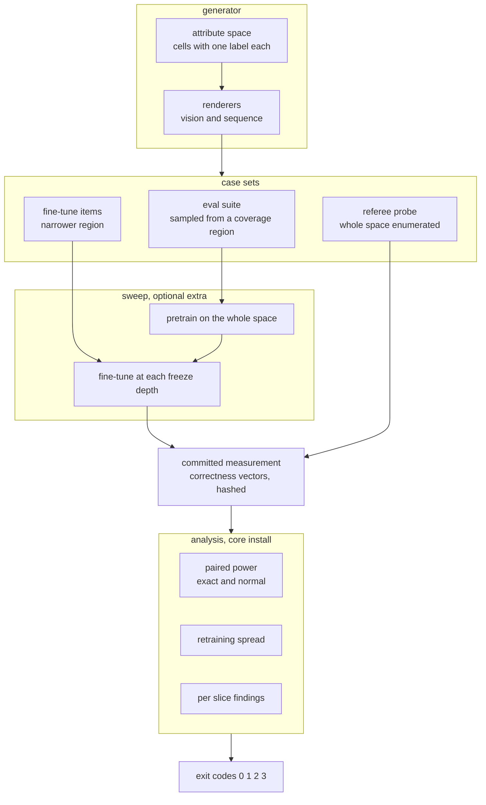

# finetune-eval-power

**Computes what a model eval suite could have detected, then goes looking for the capabilities that fell below it.** A passing suite is routinely read as evidence that fine-tuning broke nothing. This measures the largest regression a suite could have missed, and names the ones it did.

## The impossibility

Fine-tuning can break a capability the eval suite does not test, and the set of untested capabilities is unbounded. So no pass on a fixed suite can mean the model did not regress. The only honest claim available is the size of the regression the suite could have detected, and that is a number almost nobody computes.

Four questions this answers that an eval suite does not:

1. How small a regression can this suite see at all, given that it scores the same cases before and after and most of them never change their verdict?
2. Which named capabilities moved further than that, while the suite reported nothing?
3. How much of the suite's reading is the model, and how much is the fact that retraining it gives a different answer?
4. At the freeze depth a team would actually ship, what did the fine-tune buy and what did it cost?

## The uncomfortable numbers

On the vision arm, at the freeze depth the eval suite waves through:

- The suite's accuracy **changed by -1.27** points, which is to say it went up, and it raised a flag in **0 of the retrainings**. Nothing about it says stop.
- Meanwhile **8 slices regressed** past what the suite could resolve. **2 sit inside** the region the suite samples. The **worst is shape=square**, and the **worst lost 10.58** points while the suite holds **120 cases of its own** for exactly that shape.
- The reason the aggregate stays flat is that another class improved by almost as much. The suite is not insensitive. It is averaging over a dimension it does not report.
- The suite's **detection floor of 3.41** points is not the binding constraint anyway. Retraining the same configuration moves the measured result with a standard **deviation of 2.002** points, so the **noise floor reaches 3.92** points. No larger suite reduces that number.

Of **40 named capability** slices, there are **16 it never samples** and the suite has **no usable power on 19** of them. With **power below 118** cases, this suite cannot reach 80% power against a regression of any size whatsoever.

Every figure above and below is re-measured from a committed measurement by `make verify`, which also runs **317 tests** at **99.1% line coverage** and fails the build if any document quotes a figure the code no longer produces.

## Quickstart

Requires Python `3.11` or newer. No API keys, no cloud credentials, no network at runtime.

```bash
git clone https://github.com/GITHUB_USERNAME/finetune-eval-power.git
cd finetune-eval-power
make install

# the headline: what the suite missed
python -m finetune_eval_power.cli blind --arm vision

# the decision, and the refusal
python -m finetune_eval_power.cli power --arm vision --claim 2

# everything, offline
make verify
```

`make verify` runs lint, the full test suite, all five experiments and the number checker. It does not retrain anything; [ADR-004](docs/adr/ADR-004-seed-budget-and-pinned-training.md) explains why the training is captured rather than repeated, and what runs instead to keep that honest.

## What the suite could have seen, and why it is less than you think

The suite scores the same cases before and after the fine-tune, so the two accuracies are not independent samples. All the information about the difference lives in the cases whose verdict changed, and on this measurement most of them do not. That is what sets the floor, not the case count.

Treating the two readings as independent, which is the usual reflex, is the calculation the **unpaired says 5.70** about, where the paired calculation that matches the design puts the floor lower. To see a one point regression this suite **would need 5385** cases at the discordance measured here.

The second arm behaves the same way for the same reason. The **sequence ships 480** cases and holds its floor only just: the **sequence needs 473** cases before it has any power at all, so the suite that ships sits seven cases above being useless, and the **sequence arm reaches 1.65** points once it is over that line. Across **29 sequence slices named**, the **sequence missed 9**.

See [E1](docs/experiments/e1_detection_floor.json) and [ADR-003](docs/adr/ADR-003-paired-power.md).

## What it missed

The suite is **480 eval cases** drawn from a coverage region. The referee is a probe that enumerates the whole attribute space rather than sampling it, so every slice has an exact denominator: **1728 probe cases** for the vision arm, which **resolves 0.115** points per case. A slice counts as missed when it moved further than the suite's own detection floor while the suite raised no flag. The bar is the suite's floor rather than a number somebody picked, so the comparison is against the thing that was supposed to be watching.

| what the suite reports | what the probe reports |
| --- | --- |
| no regression flagged, in any retraining | eight named capabilities below the floor |
| one aggregate accuracy, moving upward | one class up by nearly eight points, another down by more than ten |
| a case count that looks comfortable | nineteen slices on which no suite size would help |

Full per-slice table with intervals in [E3](docs/experiments/e3_blind_capabilities.json).

## What freezing buys and what it costs

Freeze depth is the knob a team turns. Deeper freezing protects what the model already knew and gives up adaptation. At **shipped depth 0**, the shallowest the suite permits, the fine-tune **gains 1.15** points inside the region it trained on and **costs 1.92** points outside it. The **safest is depth 4**, which gives up most of the gain and costs nothing measurable.

So the fine-tune trades away more than it gains, and the eval suite reports the trade as an improvement. [E5](docs/experiments/e5_freeze_depth.json) has every depth.

## Which uncertainty actually dominates

Resampling eval cases answers "what if I had sampled a different eval set", which the power calculation already covers. Resampling retrainings answers "what if I ran the fine-tune again", and on this data that is much the larger of the two. Across the fine-tune, the suite's reading at the final epoch **spans 6.25** points between the best and worst retraining, and its **widest band is 9.17** points mid-run.

This is why the tool checks the retraining spread before it checks the suite size, and why it refuses rather than recommending a bigger eval set. Those two answers send a team in opposite directions, and only one of them is cheap. [E2](docs/experiments/e2_forgetting_curve.json), [ADR-004](docs/adr/ADR-004-seed-budget-and-pinned-training.md).

## The bugs the measurement found

**The number checker could not fail.** Anchor phrases are matched with a regex built from the phrase, and the builder dropped the whitespace between the placeholder and the following word. Every numeric anchor compiled to a pattern demanding the digits and the word with nothing between them, so none of them matched anything, and the checker reported every document clean. It was found by deliberately breaking a figure and watching the build pass. The fix preserves the separator, and the regression test asserts the broken form fails.

**The exact power calculation did not terminate.** Finding the rejection region walked candidate values upward with one library call each, so a single power evaluation was quadratic in the suite size and the bisection on top of it hung on the first realistic input. It is now driven by the inverse CDF, and the original walk is kept as a test referee so the fast path cannot drift from it.

**The manifest was built after the training.** A refactor renamed an attribute the manifest reads, and the failure surfaced twelve minutes into a capture with nothing written to disk. The manifest is now built and serialised before the first epoch, and a test asserts no training runs when it cannot be built.

**The forgetting curve labelled its columns backwards.** The minimum column was headed "best" on a quantity where higher is better. Nothing failed, and every reader would have drawn the opposite conclusion.

## Architecture




## Evidence


The report is generated by the tool itself, from the same committed measurement every published figure comes from. The screenshot tool frames by heading id rather than by pixel offset and fails when a heading disappears, so a shot of a stale report cannot be published silently. The capture manifest is in [docs/evidence/manifest.json](docs/evidence/manifest.json).

## The fixture

The measurement is boolean correctness vectors under `fixtures/runs/`, one entry per case per retraining per freeze depth, with a manifest hashing every array. The data behind it is generated, not downloaded, because a capability slice has to be a region of an addressable attribute space and no fixed dataset exposes one.

What is in it that makes the numbers believable is the awkward cases: small scale at low contrast, occluded by a bar through the middle, and the rotations the fine-tune never saw. Those are the regions the suite never samples, and they are enumerated in the probe at the same density as the easy ones. A probe that sampled proportionally would have given the thin slices a denominator too small to say anything with, which is the failure the resolution floor exists to catch.

## What this cannot measure

Its own section, because it is the most important one.

- **Coverage is unprovable.** 40 capability slices is not the set of capabilities. Every figure about what the suite missed is a lower bound over the capabilities somebody thought to name.
- **The effect sizes are about these models.** Both arms are small models on generated data. Take the arithmetic and the shape, not the magnitudes.
- **The narrowing was chosen, not observed.** In production the equivalent narrowing happens by accident and nobody logs how narrow it was. The absence of that logging is the production form of the same blindness.
- **Bitwise reproducibility stops at the machine boundary.** Training is deterministic within a machine and a test asserts it. Across machines it is not, which is why the measurement is captured and a separate job publishes the drift instead of pretending there is none.
- **One claim genuinely needs a real model:** the discordance of a real eval suite on a real fine-tune, measured across several retrainings. That single number is what a team should compute on their own suite, and it is cheap.

[ADR-005](docs/adr/ADR-005-boundary.md) has the full statement.

## Layout, exit codes and reproduction

```
src/finetune_eval_power/
  generator/   attribute space and the two renderers
  slices/      capability slices, coverage regions, the three case sets
  power/       paired and unpaired power, bootstrap, retraining spread
  models/      backbones with named blocks, the deterministic training loop
  tracking/    local experiment tracking, optional
  analysis.py  every published quantity, computed from the measurement
  cli.py       the exit codes
experiments/   five experiments, JSON into docs/experiments
tools/         capture, metrics collection, number and duration checks
fixtures/runs/ the committed measurement, hashed
```

| code | meaning |
| --- | --- |
| `0` | the suite can see a regression of the size claimed |
| `1` | it cannot, and a larger suite would fix that. The size needed is printed |
| `2` | refused. Retraining noise alone is wider than the claimed effect, so no suite size fixes it |
| `3` | the tool itself failed |

Code `2` is the one that matters. A power calculation always has a remedy to offer, because its model of the world contains exactly one source of noise. When the real obstacle is that the same configuration trained twice disagrees by more than the effect under discussion, that remedy is wrong and expensive.

`make verify` is lint, tests and receipts. The number checker matches anchor phrases rather than bare digits, because a checker that searches for digits passes while the sentence around them has gone stale. Break any figure in this document and the build fails.

## Stack

| choice | why here |
| --- | --- |
| Keras on TensorFlow CPU | freeze depth has to be legible and exactly true, and a named block prefix is both. No normalisation layers, which would leak through a freeze |
| Procedural generator, seeded | a capability slice is a region of attribute space, which a fixed dataset does not expose |
| SciPy and statsmodels | the exact conditional power is this repository's own, the hypothesis test is the library's, and the unpaired path is pinned against the library's |
| MLflow on a local SQLite backend | one tracked run per configuration, no server, and it disables itself rather than failing the sweep |
| Pytest, Ruff, GitHub Actions | including a job that installs without the training extra and runs the whole analysis path |

Decisions: [ADR-001 procedural generation](docs/adr/ADR-001-procedural-generation.md), [ADR-002 Keras and named blocks](docs/adr/ADR-002-keras-on-purpose.md), [ADR-003 paired and exact power](docs/adr/ADR-003-paired-power.md), [ADR-004 the seed budget and a captured measurement](docs/adr/ADR-004-seed-budget-and-pinned-training.md), [ADR-005 the boundary](docs/adr/ADR-005-boundary.md).

## The Pivot

**Out of scope: generating new eval slices to close the gaps this finds.** It is the obvious next feature and it is premature.

**Trigger condition:** when the number of undetected slices exceeds what a person can reasonably hand author. Below that, hand authored slices are better, because the value of a slice is that somebody decided it mattered. The repository computes the count, so the trigger is a measurement rather than a feeling.

Beyond that, a v2 would need the discordance of a real suite on a real model, a logged attribute distribution for the fine-tune set, and a per-slice power budget that a team sets before training rather than discovers afterwards. The first metric to watch is discordance: everything else in this repository follows from it.

## Licence

MIT, copyright Lavanya Neela.
