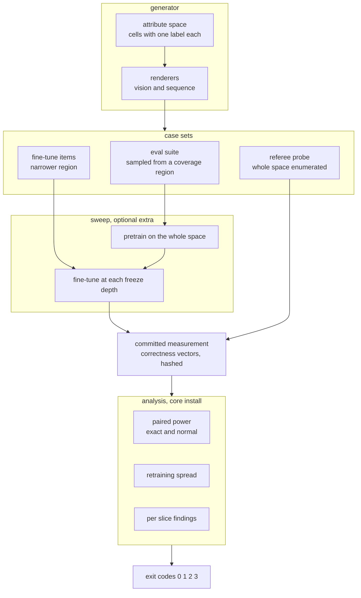
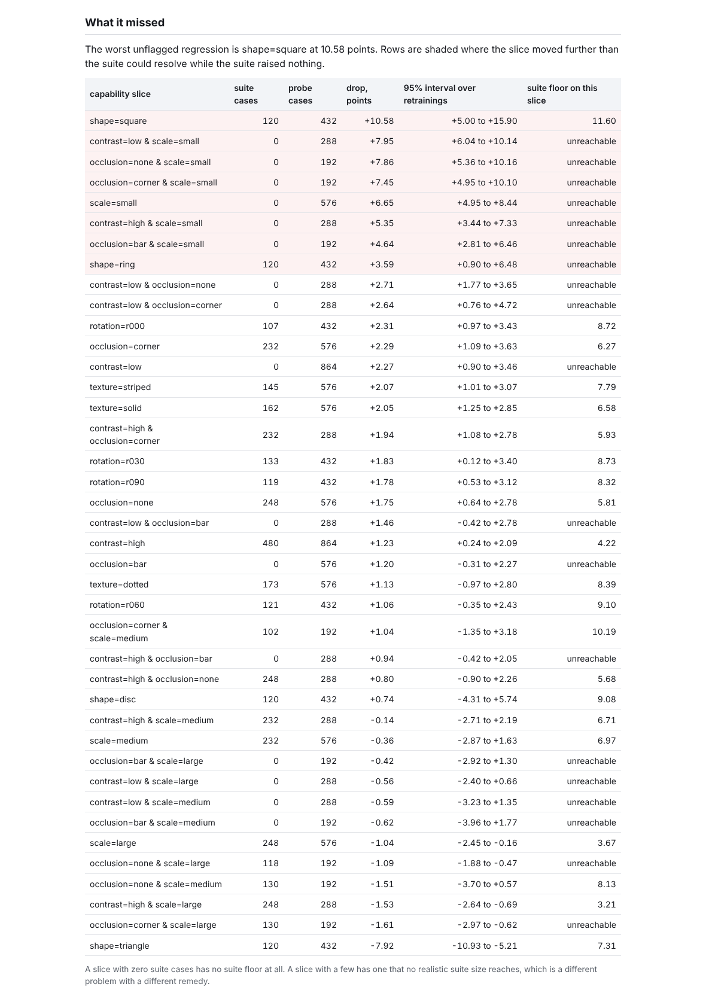
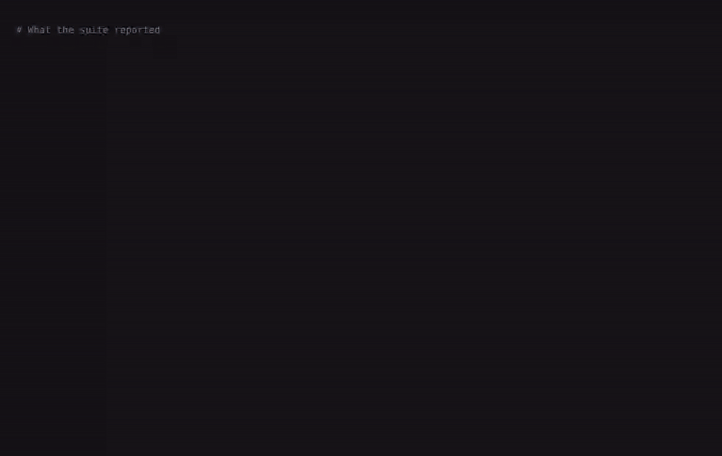

# finetune-eval-power


**Computes what a model eval suite could have detected, then names the capabilities that moved further than that without being flagged.** A passing suite is routinely read as evidence that fine-tuning broke nothing. This measures the largest regression a suite could have missed, and names the ones it did.

## The impossibility

Fine-tuning can break a capability the eval suite does not test, and the set of untested capabilities is unbounded. So no pass on a fixed suite can mean the model did not regress. The only honest claim available is the size of the regression the suite could have detected, and that is a number almost nobody computes.

Four questions this answers that an eval suite does not:

1. How small a regression can this suite see at all, given that it scores the same cases before and after and most of them never change their verdict?
2. Which named capabilities moved further than that, while the suite reported nothing?
3. How much of the suite's reading is the model, and how much is the fact that retraining it gives a different answer?
4. At the freeze depth a team would actually ship, what did the fine-tune buy and what did it cost?

## The uncomfortable numbers

On the vision arm, at the freeze depth the eval suite waves through, the suite and the referee disagree about the sign of what happened.

- The suite's **measured drop of -1.27** points is negative, which means its accuracy went up. It raised a regression flag in **0 of the retrainings**, and returned a **significant verdict in 2** of them, both in the improvement direction. Nothing about it says stop.
- The referee probe, which enumerates the whole attribute space instead of sampling a region of it, says the same fine-tune cost the model what the **probe says 1.75** points. The two disagree about the direction, not the size.
- The aggregate stays flat because the classes move against each other. Measured on the suite's own cases, one class gets worse by what the **suite shows 4.75** points while **2 improve and** hold, **together gain 9.83** points, **across 4 classes** that average to the published figure.
- Here is the part that is worse than averaging. That class is the one the **worst is shape=square**, the **suite holds 120** cases of it, and at that case count and that rate of changed verdicts **its own floor is 8.74** points, with a retraining interval whose **interval starts at -1.09**. So the suite could not have resolved it even if it had reported per class. The probe can, because it holds **432 referee cases** of that class, and it measures **worst lost 10.58** points there. Setting that drop against the suite rather than against the probe does not rescue it either: at the suite's case count for that class, and at the rate of changed verdicts the probe measures there, the suite's **own slice floor is 11.60** points, which sits above the drop.
- Across all the slices, **8 slices regressed** past what the suite could resolve, **2 sit inside** the region it samples at all, and those eight cover only **3 regions once nesting** is taken out. Some went the other way: **5 slices moved up** with intervals clear of zero, and those collapse to **2 regions the other** way under the same nesting correction. Applying that correction to one side and not to the other would be choosing the evidence.
- The suite's **detection floor of 3.41** points is not the binding constraint anyway. Retraining moves the measured result with a standard **deviation of 2.002** points, and at 1.96 of those the **noise floor reaches 3.92** points, wider than the floor. No larger suite reduces that.

Of **40 named capability** slices the suite has **no usable power on 19**: **16 it never samples** at all, and another **3 sampled too thinly** in the sense that matters here, which is that their cases almost never change verdict rather than that there are few of them. That is a size rather than a verdict, and **all 3 name a size**: the **cheapest needs 140** cases of its own slice and the **dearest needs 459**, against the counts they carry today. A slice whose cases never changed verdict at all would name no size, which is the sharper form of the same problem and is why the count is published next to them. Separately, with **power below 118** cases nothing at this discordance reaches 80% power at any effect size, and the suite that ships is larger than that, so its problem is not its size.

Every figure above and below is re-measured from a committed measurement by `make verify`, which also runs **333 tests** at **99.1% statement and branch** coverage, evaluates the relations the prose asserts between those figures, and fails the build if any of the seven checked documents quotes a figure the code no longer produces. That coverage figure is over the modules a core install executes; the training, sweep and tracking modules are excluded from its denominator on purpose, because `make verify` has to run from a bare clone without a deep learning framework, and a figure a reviewer cannot reproduce is worse than no figure. They are exercised by the CI jobs that install the training extra.

## Quickstart

Requires Python `3.11` or newer. No API keys, no cloud credentials, no network at runtime.

One placeholder ships unfilled, in the clone URL below. Run `make set-handle HANDLE=your-handle` once after cloning and it is replaced everywhere, and the CI badge is added at the same time. It is left as a placeholder rather than guessed, because a badge pointing at a repository that does not exist renders as "unknown" and is the first thing a reviewer notices.

```bash
git clone https://github.com/GITHUB_USERNAME/finetune-eval-power.git
cd finetune-eval-power
make install

# the headline: what the suite missed
python -m finetune_eval_power.cli blind --arm vision

# the decision, and the refusal
python -m finetune_eval_power.cli power --arm vision --claim 2

# everything, offline
make verify
```

`make verify` runs lint, the offline test suite, all five experiments and the number checker. The ones that train a model are deselected there and run in CI instead. It does not retrain anything; [ADR-004](docs/adr/ADR-004-seed-budget-and-pinned-training.md) explains why the training is captured rather than repeated, and what runs instead to keep that honest.

## What the suite could have seen, and why it is less than you think

The suite scores the same cases before and after the fine-tune, so the two accuracies are not independent samples. All the information about the difference lives in the cases whose verdict changed, and on this measurement most of them do not. That is what sets the floor, not the case count.

Treating the two readings as independent, which is the usual reflex, is the calculation the **unpaired says 5.70** about, where the paired calculation that matches the design puts the floor lower. To see a one point regression this suite **would need 5385** cases at the discordance measured here.

The second arm behaves the same way, with one honest caveat. The **sequence ships 480** cases and the **sequence needs 473** before it has any power at all, so the suite that ships sits seven cases above being useless, and the **sequence arm reaches 1.65** points once it is over that line. That floor looks sharper than the vision arm's and is not: its cases change verdict so rarely that the largest drop the arm can even represent is barely above the floor itself, so the suite reaches its target power only if essentially every changed case is a regression. Across **29 sequence slices named**, the **sequence missed 9**.

See [E1](docs/experiments/e1_detection_floor.json) and [ADR-003](docs/adr/ADR-003-paired-power.md).

## What it missed

The suite is **480 eval cases** drawn from a coverage region. The referee is a probe that enumerates the whole attribute space rather than sampling it, so every slice has an exact denominator: **1728 probe cases** for the vision arm. Denominators differ by slice and the floors differ with them, so the range across slices is published rather than one end of it: across the whole probe one case is a little over what the **probe resolves 0.057** points, while among the slices themselves the **finest slice resolves 0.115** points and the **thinnest slice resolves 0.52** points, coarser than the finest by more than a factor of four.

A slice counts as missed when three things hold together: the suite raised no regression flag in a majority of retrainings, the slice's drop exceeds the suite's own detection floor, and its interval across retrainings stays clear of zero. The materiality bar is the suite's floor rather than a number somebody picked, so the comparison is against the thing that was supposed to be watching, and the interval condition is there so a slice cannot be called regressed on the strength of one unlucky retraining.

| what the suite reports | what the probe reports |
| --- | --- |
| no regression flagged, in any retraining | eight named slices past the suite's floor, covering three regions |
| one aggregate accuracy, moving upward | the aggregate over the whole space moving downward, with five slices moving up |
| a case count that looks comfortable | **no usable power on 19** of the **40 named capability** slices |

Full per-slice table with intervals, denominators and per-slice floors in [E3](docs/experiments/e3_blind_capabilities.json).

## What freezing buys and what it costs

Freeze depth is the knob a team turns. Deeper freezing protects what the model already knew and gives up adaptation. At **shipped depth 0**, which is the shallowest freeze the suite does not object to and on this measurement it objects at none of them, the fine-tune **gains 1.15** points inside the region it trained on and **costs 1.92** points outside it. Those two carry opposite sign conventions by construction, so to be explicit: the first is an improvement and the second is a loss.

Both are priced before they are used. The in-region figure is measured over **96 cases in the region**, so **one of them is 1.04** points and the gain is barely more than a single flipped case, with a **gain spread of 1.43** points across retrainings. It is at the resolution floor and should be read as "no measurable in-region gain" rather than as a win. The loss outside the region is priced the same way and survives it: its **outside spread of 1.73** points across retrainings is narrower than the loss itself. That asymmetry is the only reason one side of this trade is stated as a cost while the other is not stated as a gain.

The other end of the dial buys nothing either. The **safest is depth 4**, where the outside-region loss is what **depth four moves -0.16** points, which being a negative loss is a small gain, and is in any case smaller than its own retraining spread, since **that spread is 1.52** points. So the honest summary of the trade is that the fine-tune buys nothing this measurement can resolve, costs almost two points outside the region it trained on, and the eval suite reports the whole thing as an improvement. [E5](docs/experiments/e5_freeze_depth.json) has every depth.

## Which uncertainty actually dominates

Both of these describe a single measurement, which is the only way they can be compared. Resampling the eval cases of one retraining puts a 95% interval around the suite's reading, and **resampling cases gives 3.54** points of width. Retraining the same configuration with the eval cases held fixed gives a wider one: **retraining gives 7.85** points.

A larger eval suite shrinks the first and leaves the second untouched, which is why the tool checks the second before it recommends anything about the first. Those two answers send a team in opposite directions and only one of them is cheap. The refusal threshold itself is the half-width of that second interval, so the **noise floor reaches 3.92** points while the full interval is twice that.

The same instability shows up along the fine-tune. The change the suite reports at the final epoch **spans 6.25** points between the best and worst retraining, while the final accuracy **readings span 3.33** points themselves. The **widest band is 9.17** points **at epoch 2** of twelve, so the epoch a team happened to stop at moves the number they report. [E2](docs/experiments/e2_forgetting_curve.json), [ADR-004](docs/adr/ADR-004-seed-budget-and-pinned-training.md).

## The bugs the measurement found

**The number checker could not fail.** Anchor phrases are matched with a regex built from the phrase, and the builder dropped the whitespace between the placeholder and the following word. Every numeric anchor compiled to a pattern demanding the digits and the word with nothing between them, so none of them matched anything, and the checker reported every document clean. It was found by deliberately breaking a figure and watching the build pass. The fix preserves the separator, and the regression test asserts the broken form fails.

**The exact power calculation did not terminate.** Finding the rejection region walked candidate values upward with one library call each, so a single power evaluation was quadratic in the suite size and the bisection on top of it hung on the first realistic input. It is now driven by the inverse CDF, and the original walk is kept as a test referee so the fast path cannot drift from it.

**The manifest was built after the training.** A refactor renamed an attribute the manifest reads, and the failure surfaced twelve minutes into a capture with nothing written to disk. The manifest is now built and serialised before the first epoch, and a test asserts no training runs when it cannot be built.

**The size lookup raised on exactly the slices it existed for.** A late pass added a published size to each underpowered slice, the suite size that would give it power, and asked the power routine for one slice at a time. The routine refuses a discordance of zero, correctly, because a slice whose cases never change verdict carries no information for any suite size to work with. That is not an edge case here: it is the extreme of the very condition that puts a slice on that list, so the property that documents read raised rather than returned, and a measurement where nothing moved could not be collected at all. The size is now `None` for those slices, a relation asserts that every underpowered slice on the shipped measurement still names one, and the regression test is paired with a second test that calls the unguarded routine and asserts it raises.

**The forgetting curve labelled its columns backwards.** The minimum column was headed "best" on a quantity where higher is better. Nothing failed, and every reader would have drawn the opposite conclusion.

## Architecture





## Evidence



The report is generated by the tool itself, from the same committed measurement every published figure comes from. The screenshot tool frames by heading id rather than by pixel offset and fails when a heading disappears, so a shot of a stale report cannot be published silently. It also reads back the verdict badge's computed style and refuses to publish if the badge is invisible, which is a failure that shipped twice on earlier projects.



That is a replay, not a screen recording. Every line is real captured stdout from a command that ran, each segment is paced by the wall time that command took, and the last segment deliberately corrupts a published figure so the checker can be seen failing. [docs/video/manifest.json](docs/video/manifest.json) lists every command with its exit code, and [docs/evidence/manifest.json](docs/evidence/manifest.json) lists each screenshot with the headings it was framed by and the badge reading.

## The fixture

The measurement is boolean correctness vectors under `fixtures/runs/`, one entry per case per retraining per freeze depth, with a manifest hashing every array. The data behind it is generated, not downloaded, because a capability slice has to be a region of an addressable attribute space and no fixed dataset exposes one.

What is in it that makes the numbers believable is the awkward cases: small scale, low contrast, and a bar occlusion through the middle. Those three attributes and their pairs are the sixteen slices the suite never samples. Rotation is deliberately not among them: the fine-tune set covers every rotation, so no rotation slice is held out, and the README says so rather than letting a reader assume the held-out set is larger than it is. Those are the regions the suite never samples, and they are enumerated in the probe at the same density as the easy ones. A probe that sampled proportionally would have given the thin slices a denominator too small to say anything with, which is the failure the resolution floor exists to catch.

## What this cannot measure

Its own section, because it is the most important one.

- **Coverage is unprovable.** 40 capability slices is not the set of capabilities. Every figure about what the suite missed is a lower bound over the capabilities somebody thought to name.
- **The effect sizes are about these models.** Both arms are small models on generated data. Take the arithmetic and the shape, not the magnitudes.
- **The narrowing was chosen, not observed.** In production the equivalent narrowing happens by accident and nobody logs how narrow it was. The absence of that logging is the production form of the same blindness.
- **Bitwise reproducibility stops at the machine boundary.** Training is deterministic within a machine and a test asserts it. Across machines it is not, which is why the measurement is captured and a separate job publishes the drift instead of pretending there is none.
- **One claim genuinely needs a real model:** the discordance of a real eval suite on a real fine-tune, measured across several retrainings. That single number is what a team should compute on their own suite, and it is cheap.

[ADR-005](docs/adr/ADR-005-boundary.md) has the full statement.

## Layout, exit codes and reproduction

```
src/finetune_eval_power/
  generator/   attribute space and the two renderers
  slices/      capability slices, coverage regions, the three case sets
  power/       paired and unpaired power, bootstrap, retraining spread
  models/      backbones with named blocks, the deterministic training loop
  tracking/    local experiment tracking, optional
  analysis.py  every published quantity, computed from the measurement
  cli.py       the exit codes
experiments/   five experiments, JSON into docs/experiments
tools/         capture, metrics collection, number and duration checks
fixtures/runs/ the committed measurement, hashed
```

| code | meaning |
| --- | --- |
| `0` | the tool answered and the answer is the reassuring one: `power` means the suite can see a regression of the size claimed, `blind` means nothing fell past its floor unnoticed |
| `1` | the tool answered and the answer is the unwelcome one: `power` prints the suite size that would work, `blind` lists the capabilities it found |
| `2` | refused. Retraining noise alone is wider than the claimed effect, so no suite size fixes it |
| `3` | the tool itself failed |

`suite`, `curve`, `report` and `metrics` describe the measurement rather than judging it, so they return `0` unless the tool fails. The headline command in the quickstart is `blind`, and on this measurement it exits `1`, because it found something.

Code `2` is the one that matters. A power calculation always has a remedy to offer, because its model of the world contains exactly one source of noise. When the real obstacle is that the same configuration trained twice disagrees by more than the effect under discussion, that remedy is wrong and expensive.

`make verify` is lint, tests and receipts. The number checker matches anchor phrases rather than bare digits, because a checker that searches for digits passes while the sentence around them has gone stale. Break any figure written in digits in this document and the build fails, and the checker also evaluates the relations the prose asserts between figures, because two correctly guarded numbers can sit either side of a false comparison. Figures spelled as words are guarded only where they sit inside an anchor.

## Stack

| choice | why here |
| --- | --- |
| Keras on TensorFlow CPU | freeze depth has to be legible and exactly true, and a named block prefix is both. No normalisation layers, which would leak through a freeze |
| Procedural generator, seeded | a capability slice is a region of attribute space, which a fixed dataset does not expose |
| SciPy and statsmodels | the exact conditional power is this repository's own, the hypothesis test is the library's, and the unpaired path is pinned against the library's |
| MLflow on a local SQLite backend | one tracked run per configuration, no server, and it disables itself rather than failing the sweep |
| Pytest, Ruff, GitHub Actions | including a job that installs without the training extra and runs the whole analysis path |

Decisions: [ADR-001 procedural generation](docs/adr/ADR-001-procedural-generation.md), [ADR-002 Keras and named blocks](docs/adr/ADR-002-keras-on-purpose.md), [ADR-003 paired and exact power](docs/adr/ADR-003-paired-power.md), [ADR-004 the seed budget and a captured measurement](docs/adr/ADR-004-seed-budget-and-pinned-training.md), [ADR-005 the boundary](docs/adr/ADR-005-boundary.md).

## The Pivot

**Out of scope: generating new eval slices to close the gaps this finds.** It is the obvious next feature and it is premature.

**Trigger condition:** when the number of undetected slices exceeds what a person can reasonably hand author. Below that, hand authored slices are better, because the value of a slice is that somebody decided it mattered. The repository computes the count, so the trigger is a measurement rather than a feeling.

Beyond that, a v2 would need the discordance of a real suite on a real model, a logged attribute distribution for the fine-tune set, and a per-slice power budget that a team sets before training rather than discovers afterwards. The first metric to watch is discordance: everything else in this repository follows from it.

## Licence

MIT, copyright Lavanya Neela.
